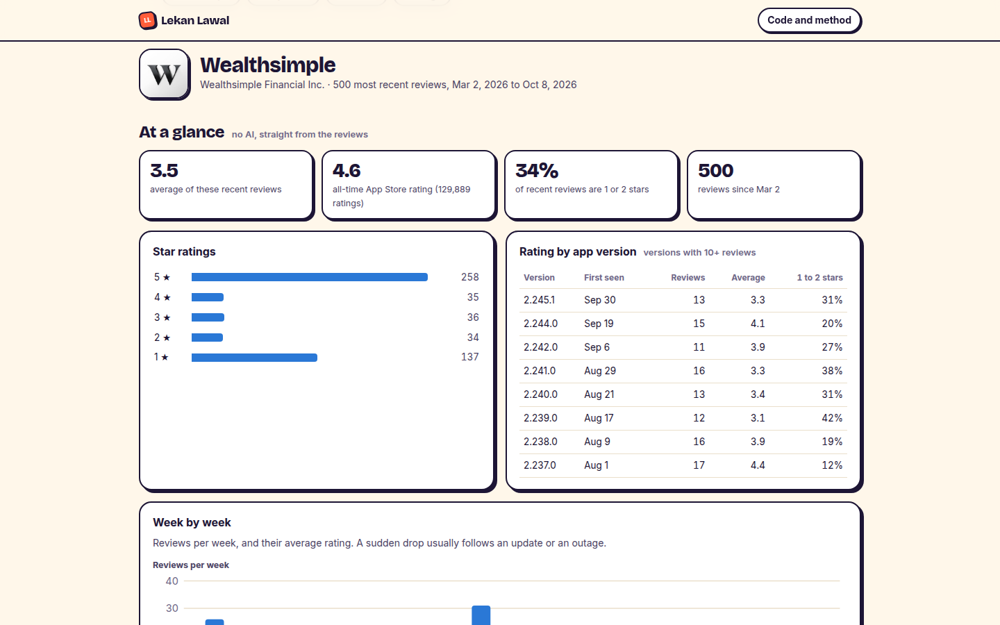

# App Review Insights

Pick any iPhone app and see what its users love, hate and ask for, from its latest App Store reviews.

[Try it on any app](https://lekanlawal1.github.io/app-review-insights/)



## Why I built it

An app's star rating hides a lot. Years of happy users can keep it at 4.6 while this month's users are having a terrible time. Wealthsimple is a good example: 4.6 stars all-time, but its latest 500 Canadian reviews average 3.5, and a third are 1 or 2 stars. I wanted a quick way to see that gap, and the reason for it.

## How it works

The page pulls up to 500 recent reviews straight from Apple's public feed. The numbers come from plain code, not AI: the star breakdown, ratings week by week, and the average rating for each app version, which is often the most useful part because it shows which update made things worse.

Then Gemini reads the reviews and groups them into complaints, praise and feature requests, with quotes. Before you see any of it, the page checks the AI's work. Every quote has to appear word for word in a real review, and that review has to be one the AI put in the same theme. The AI never writes a number. How many reviews mention a theme, and their average rating, are counted by code.

## What I found

My first version only checked that quotes existed. Testing showed that wasn't enough: a happy "the premise of the app is exceptional" showed up as evidence under "Slow customer support". The quote was real, but from the wrong review. Now a quote only counts if its review belongs to that theme, and a "complaint" whose reviews average 4 stars or more gets flagged instead of trusted.

On Wealthsimple, all 28 quotes passed both checks, and the complaint themes averaged 2.1 stars against 5.0 for praise, so the labels match how people actually rated.

## Limits

Apple only shares the 500 most recent written reviews per app and country, so this covers recent months. The checks prove quotes are real and in the right place. They don't prove the AI grouped every review the way a person would. Measuring that needs a person's labels, so I built the tooling for it: [a labelling page](https://lekanlawal1.github.io/app-review-insights/eval/label.html) where someone labels 100 reviews without seeing the AI's choices, and [a script](eval/score.mjs) that reports precision and recall with confidence intervals. The labels are the missing step, so there is no result to quote yet.

## Run it

```bash
node --test test/*.test.mjs
(cd worker && node --test test/*.test.mjs)
python3 -m http.server 8799 -d site       # http://localhost:8799
```

## More

[docs/details.md](docs/details.md) has the full write-up, including every check and what happens when one fails. For AI triage on real support messages, see [Sorted](https://github.com/lekanlawal1/project2-ai-ticket-triage).
